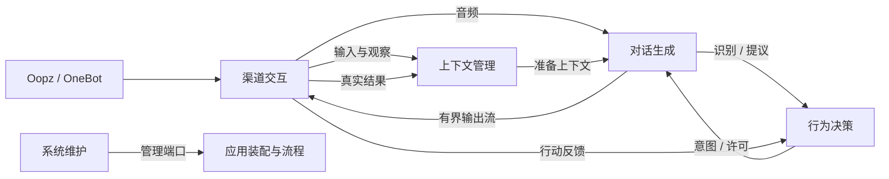

# 系统架构

Ooptra 连接 Oopz 与 OneBot v11/AstrBot，提供文字代理、实时语音和 Web 控制台。现有业务实现已归入五模块；应用装配在 `src/app/`，HTTP 适配在 `src/webui/`，共享机制在 `src/core/`，内置上游 SDK 保留在 `src/oopz_sdk/`。旧 `bridge`、`oopz`、`onebot_v11`、`voice_agent` 命名空间已退休，静态检查禁止恢复或继续导入。

先按下表选择模块，阅读该模块公开接口和类型，再深入内部实现。安装与操作见 [README](README.md)，工程约束见 [代码要求](docs/coding-standards.md)，实施证据与设计取舍见 [重构记录](docs/superpowers/plans/2026-11-08-module-refactor-readiness.md)。

## 最高层：五个模块

| 模块 | 回答的问题 | 拥有的知识和权威状态 | 入口 |
| --- | --- | --- | --- |
| 渠道交互 | 外部发生了什么，动作实际执行了吗？ | Oopz/OneBot 协议、身份映射、账号和浏览器绑定、实际房间、输入授权/VAD、播放和执行台账 | [channels](src/channels/README.md) → `api.py` / `models.py` |
| 上下文管理 | 机器人现在知道什么，哪些信息可使用或写入？ | 版本化情境、来源绑定、近期历史、授权、SQLite 事务及外部记忆 outbox/回执 | [context](src/context/README.md) → `api.py` / `models.py` |
| 行为决策 | 下一步应做什么？ | 输入尝试配额、触发去重、接话概率/关键词/窗口、冷却、抢话许可、串门阶段和耐久访问额度 | [behavior](src/behavior/README.md) → `api.py` / `models.py` |
| 对话生成 | 如何识别输入并形成表达？ | 供应商协议、识别/控制候选、表达任务与有界事件流、Live 提议/许可、独立试听/自检 | [dialogue](src/dialogue/README.md) → `api.py` / `models.py` |
| 系统维护 | 应用如何配置、运行和恢复？ | 配置版本/CAS、保存与应用回执、凭据、维护计划/任务、备份、父子交接、进程监督和激活屏障 | [operations](src/operations/README.md) → `api.py` / `models.py` |

五模块在同一个 Python/asyncio 应用中协作。模块内部按独有知识组织，不为每次调用增加转发层；不要求独立进程或消息中间件。[应用目录](src/app/README.md) 只装配端口、关联原会话与因果 ID、传递结果并管理流程取消。

## 抽象层级与协作

1. **应用能力层**：五模块的公开类型、任务、查询及生命周期端口。
2. **内部实现与适配层**：SDK、OneBot、AstrBot 协议、模型 HTTP/WebSocket、浏览器音频、SQLite/文件和操作系统。原始数据在拥有该协议的边界解析。
3. **装配与公共机制**：`main.py` / `launcher.py` 是薄入口；`app` 连接模块和管理流程；`core` 提供路径、日志、原子文件等通用机制。

这是运行时数据流，不是静态导入图。跨模块反向协作通过使用方声明的窄端口注入，例如生成的 `ContextToolPort`、串门的 `VisitsHost`、渠道的 `VoiceLifecycle` 和维护的 `RuntimeControl`。

### 静态依赖与类型归属

| 导入方 | 允许的直接业务依赖 |
| --- | --- |
| `channels` | 无 |
| `context` | `channels.models` |
| `behavior` | `channels.models`、`context.models` |
| `dialogue` | `channels.models`、`context.models`、`behavior.models` |
| `operations` | 无 |
| `app` / HTTP 适配 | 五模块公开接口、类型及装配工厂 |

各模块可依赖 `core`，`core` 不反向依赖业务。SDK 导入只允许渠道内部适配；HTTP 不供业务反向导入。`api.py` / `models.py` 独立于实现，包工厂返回公开端口；跨模块不能取得 SDK、数据库句柄或可修改的内部字典。`scripts/check_architecture.py` 检查目录、依赖方向、公开导入和退休路径；它不能证明动态调用或每份状态的归属，仍需行为测试与审查。

## 接口与数据契约

每份可变状态只有一个拥有者。输入经过解析后保留具名结构；快照和跨模块证据不可变。接口包括成功含义、错误、取消、容量与顺序，精确签名以代码 docstring 为准。

| 事实或能力 | 权威定义 | 关键约束 |
| --- | --- | --- |
| 目标、实际会话和房间动作 | `channels.models` / `Channel` | `RoomTarget` 不证明已进房；`SessionRef` 绑定进程、账号、会话；执行前复查真实状态 |
| 播放流与终态 | `OutputFrame` / `PlaybackRequest` / `PlaybackResult` | 连续帧序号、固定单声道 PCM16 格式、期限和单播放器；实际排空才 completed；部分/未知范围不冒充完整播放 |
| 情境和准备结果 | `ContextRevision` / `PreparedContext` / `ContextRef` | 观察按连接和序号去重；明确 session 观察切换投影；准备结果固定原来源、历史和授权 |
| 历史与外部记忆 | `ContextService` / `OutputRecord` | 稳定输入/动作 ID 幂等；历史与 outbox 同一 SQLite 事务；外部确认是独立回执，按目标重试 |
| 尝试和行为结果 | `AttemptPermit` / `SpeechIntent` / `Behavior` | ASR 前受理一次并扣额，沉默/失败不退款；意图与反馈不重复扣额；旧会话不能改变新会话状态 |
| 表达任务 | `ExpressionJob` / `GenerationEvent` / `GeneratedAudio` | 单订阅、有界背压、唯一生成终态；源异常和缺终态不能当正常 EOS；提前拒绝也关闭源 |
| 实时模型会话 | `LiveSession` | 持续输入；提议交行为决定 Allow/Hold/Reject；许可绑定提议版本和原上下文；有限迟到窗口不复活已拒轮次 |
| 配置和维护 | `Configuration` / `Maintenance` / `RuntimeControl` | 文件版本/CAS、请求幂等、保存与应用分别确认；静默、持久交接和真实进程退出后才切换 |

### 共同约束

- 生成完成、渠道发送/播放完成、本地事务提交、外部记忆确认分别表达；通过原 action/input/session ID 关联。
- 异步任务有拥有者、期限、取消和异常观察。取消后等待收尾；已受理的磁盘线程/渠道副作用仍观察真实结果。
- 音频与生成流有界。采集跨线程交给所属 loop，满载标记断点并清除不连续的切句窗口；旧回调不能进入新绑定。
- 模型没有权威历史写入口。记忆工具只接受绑定准备结果的类型化端口；模型参数不能选择任意人格、房间或写授权。
- 失败由负责消费的边界记录一次安全诊断，不记录正文、密钥或供应商原始错误。诊断耗时明确区分串行阶段和 Live/流式重叠。

## 主要流程

### 收到语音后回应

渠道解析、授权并提供有界音频增量/切句 → 行为在识别前登记稳定输入并返回尝试许可 → 支持流式ASR的生成后端边接收边识别，切句后确认最终文本；其他级联后端整句识别 → 生成做必要控制候选解释 → 上下文记录识别观察 → 行为返回沉默、控制或发言意图 → 准备不可变上下文 → 启动表达任务 → 渠道消费生成帧并确认实际播放 → 行为接收真实执行结果，上下文按实际证据提交。

分类不可用/非法不能当合法 NoControl 继续回复。每次已受理尝试在 finally 结束，生成前失败用 `NotExecuted`，开始执行后使用渠道自己的结果。输入事实可以独立保存；只有实际完成的表达才能成为完整助手历史。

### 持续实时对话与主动请求

Live 不强迫文字中转。持续音频输入和提议事件分开，应用单消费事件，将提议交行为产生许可；生成拥有有限缓冲、提议版本与工具调用，渠道拥有播放。慢播放和历史提交不阻塞模型 reader。主动串门的问候/告别、管理发言也使用表达任务与实际结果提交。

Live 语音退房工具先回包 `scheduled` 表示受理，独立离场任务完成告别播放后用同一 action ID 退房并反馈实际结果；回包不伪称已经退出。新增安静时自动开话题属于产品功能扩展，本轮保留原有自动串门/问候和实时对话能力，没有默认启用新的自主闲聊。

### 外部文字机器人

Oopz → OneBot → AstrBot → OneBot → Oopz 的代理路由全部在渠道适配内。AstrBot 负责这一路的决策、生成和外部记忆；应用不会再为同一文字消息启动本地生成。语音通过独立的已认证轮询/回执通路同步 AstrBot 上下文；身份映射数据库及 wire protocol=1 保持兼容。

### 配置与维护

管理入口解析请求 → 维护模块检查版本/屏障并提交配置或维护计划 → 装配管理端口报告各组件应用结果。重复请求按持久回执处理；保存成功和应用失败可分别查询。候选版本在父提交前只开放查询/health，不连接平台或启动自动行为。

维护先停止接收业务、静默流程和资源，持久化 handoff 后通知主循环退出；父确认进程身份及真实退出后切换、重启、健康检查，失败回滚。外部 Oopz 暂时断连不单独视作版本回滚理由。备份通过 SQLite backup 捕获一致状态，归档完整校验后原子发布。

## 实现取舍与验证入口

命令返回结果与查询、音频输入端口、Live 单消费事件各承载不同顺序与背压，不再增加没有真实消费者的万能事件总线。串门保留行为模块拥有的异步访问任务，通过窄执行端口编排完整访问；不把等待/重试阶段搬入应用以机械统一 `decide` 方法。具体取舍在各模块说明及 [接口演练](docs/superpowers/specs/2026-11-08-module-boundaries.md) 记录。

测试入口见 [tests](tests/README.md)；真实语音验证见 [双机器人验收](docs/bot-pair-acceptance.md)。架构完成以公开路径实际使用、状态唯一归属、故障反例、旧调用者清零和实际验收为依据。Git 提交和验收分别绑定 SHA；本地协议测试不代替真实房间/模型验证。部署级进程崩溃、真实生产升级/恢复和人耳声学效果不能仅靠本地测试声称已验证。

配置、密钥和用户数据位置继续遵循 [配置与维护](docs/operations.md)、[语音指南](docs/voice-guide.md) 及 [AstrBot 同步](docs/astrbot-context-sync.md)。
