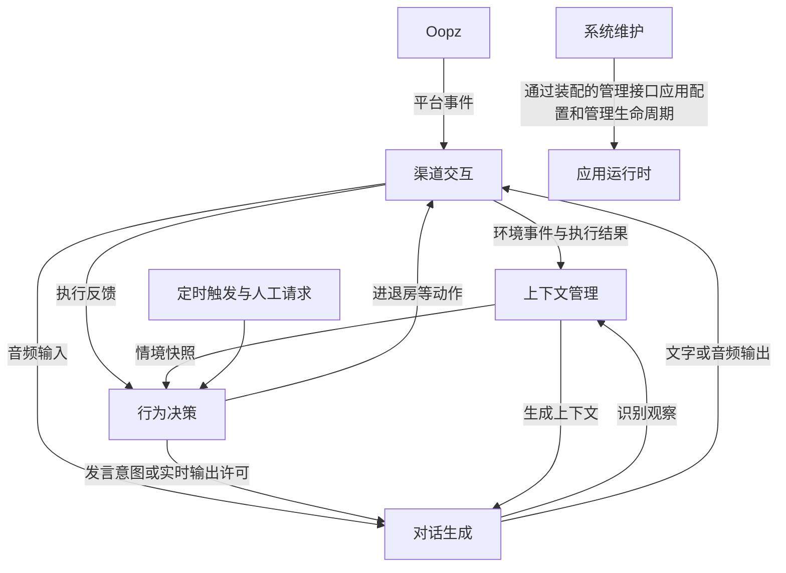

# 系统架构

Ooptra 的目标是让机器人在 Oopz 中感知环境、理解情境、决定行动并与人交互，同时支持安全的配置和维护。

本文定义五模块职责、接口和状态归属。五模块均已有真实运行实现，已迁入渠道音频与房间、上下文历史与 AstrBot 来源、行为调度与配额、全部语音供应商，以及配置/备份/更新监督。公开代码接口是当前事实；模块内部文档将尚未实现的情境投影、事务 outbox、生成 job、完整播放台账等高级契约明确标为目标设计。跨模块语音编排仍在 `VoiceAgent` / `VoiceRuntime`，文字协议适配仍在原集成目录，不能把本次迁移视作全部目标契约已经完成。安装与操作见 [README](README.md)，工程要求见 [代码要求](docs/coding-standards.md)。

## 最高层：五个模块

| 模块 | 回答的问题 | 职责 | 拥有的状态 |
| --- | --- | --- | --- |
| 渠道交互 | 外部发生了什么？行动如何执行？ | 对接 Oopz，归一化消息、音频和成员事件；执行发言、进退房等动作 | 连接、实际房间会话、音频传输、播放任务、执行代次和平台标识映射 |
| 上下文管理 | 机器人现在知道什么？ | 汇集环境观察、人格、近期对话和相关记忆；按实际结果记录历史并同步外部记忆 | 带版本的情境、历史、记忆检索及同步请求、持久化待写队列与回执 |
| 行为决策 | 下一步应该做什么？ | 根据情境、触发原因和策略，选择沉默、回应、主动发言或房间动作 | 决策调度、主动行为冷却、配额、策略及待执行意图 |
| 对话生成 | 如何识别输入并形成表达？ | 识别语音输入；根据发言意图和上下文生成文字或语音；封装模型与语音合成差异 | 本次生成任务、模型连接和生成流；可重建的模型会话缓存 |
| 系统维护 | 应用如何配置、运行和恢复？ | 管理配置应用、运行状态、备份、更新、恢复和回滚 | 配置版本、维护任务、备份索引、进程身份与健康检查结果 |

五个模块是逻辑划分，初期继续使用同一 Python 应用进程和 asyncio。模块内部可以有多个对象；目录移动、独立进程和独立部署均按实际需要推进。

## 抽象层级与协作

1. **应用能力层**：上述五个模块，通过明确类型和契约协作。
2. **实现与适配层**：Oopz SDK、OneBot、AstrBot 插件协议、模型供应商、文件与 SQLite、浏览器音频和操作系统。协议对象在适配处转换，调用者使用应用类型。
3. **装配与公共机制**：入口负责连接模块和生命周期；日志、路径、认证和原子文件写入提供共享机制。WebUI、HTTP 和定时器是请求入口，不另算业务模块。

入口中的 [应用装配与流程](src/app/README.md) 负责按契约传递事件、快照、意图和结果，管理一次流程的取消与收尾；业务判断由对应模块负责。初期使用进程内调用与受控任务，无需引入消息中间件。

上图是运行时数据流，**不是静态导入图**。级联语音先由行为按输入尝试准入并预留额度，再经过“渠道音频 → 对话生成的识别能力 → 上下文观察与行为决策”；空识别、沉默和控制仍消耗已开始的尝试，未决定回应时不启动表达生成。Live 采用持续模型会话，输入持续传递，输出轮次经行为许可再交渠道；不强制文字中转，也不在每次触发时重连模型。详细能力契约见各模块导航。

### 静态依赖与类型归属

目标模块允许的直接业务依赖如下；未列出的依赖默认禁止。类型由拥有对应知识的模块定义，使用者只引用公开类型，不导入实现。运行时由 `app` 注入实例并传递消息，反馈不产生反向导入。需要回调能力时由使用方声明窄端口并注入，例如生成的记忆工具端口和维护的管理端口；这允许受控运行时协作，不授予导入对方实现的权限。

| 导入方 | 允许的业务依赖 | 不允许承担的职责 |
| --- | --- | --- |
| `channels` | 无 | 策略、生成、记忆规则 |
| `context` | `channels.models` | 控制真实房间、调用模型 |
| `behavior` | `channels.models`、`context.models` | SDK 执行、模型实现 |
| `dialogue` | `channels.models`、`context.models`、`behavior.models` | 直接播放、变更配额、写权威记忆 |
| `operations` | 无；本模块声明管理端口，由装配注入 | 业务私有状态及 HTTP 处理 |
| `app` | 五模块公开 API/类型及包工厂 | 冷却/提示/重试/房间锁等业务知识 |

各模块可依赖 `core` 的通用机制；`core` 不反向依赖五模块。外部协议和供应商只出现在所属模块适配内；WebUI/独立 HTTP 入口完成认证、解析和响应，通过公开 API 或应用任务入口调用，不供业务反向导入。`main.py`、`launcher.py` 保留薄入口，装配能力按实际迁移进入 `src/app/`。

架构脚本现已按此矩阵限制五模块静态依赖，并禁止业务导入 `app`、`core` 反向导入五模块。矩阵允许的五模块依赖构成无环图，逆向业务环会被拒绝；旧模块、模块内部的环、动态导入与属性访问仍需审查。正反例见 `tests/architecture/test_module_layout.py`。

## 接口与数据契约

五模块的已实现能力均从各自公开接口和类型进入；未实现能力继续标记为目标设计。以下为共同设计要求。接口包括数据类型、成功含义、错误、取消和顺序约束；实现时使用具名类型、枚举或联合类型，替换通用字典和含义不明的布尔开关。原始输入先解析为有效结构，后续代码直接使用解析结果。

模块顶层提供接口导航；Agent 先按职责选择模块，再阅读该模块的公开接口，最后深入内部实现：

| 模块 | 导航入口 | 迁入后的公开代码入口 |
| --- | --- | --- |
| 渠道交互 | [channels](src/channels/README.md) | `src/channels/api.py` |
| 上下文管理 | [context](src/context/README.md) | `src/context/api.py` |
| 行为决策 | [behavior](src/behavior/README.md) | `src/behavior/api.py` |
| 对话生成 | [dialogue](src/dialogue/README.md) | `src/dialogue/api.py` |
| 系统维护 | [operations](src/operations/README.md) | `src/operations/api.py` |

各模块 README 的子模块导航链接到内部详细设计，明确内部接口、数据字段、状态机、依赖、迁移切片和待补测试；不把设计文档目录视作已实现的 Python 包。装配层的任务与管理端口见 [应用装配](src/app/README.md)。

目录规则见 [模块目录与接口导航](docs/coding-standards.md#模块目录与接口导航)，测试布局见 [测试导航](tests/README.md)。导航中明确标记尚未实现的契约；首条真实路径迁入时才创建类型和实现。

有 I/O 或等待的接口采用异步实现；快照读取返回只读数据。装配还负责各模块的启动与停止，这些生命周期接口属于管理面。

### 跨模块数据的权威定义

| 类型/事实 | 拥有者 | 说明 |
| --- | --- | --- |
| 范围、会话引用、平台事件、输出帧、执行命令与结果 | `channels.models` | 房间目标与实际会话分开；事实包含来源 ID、序号与可确认程度 |
| 情境、准备上下文、来源/授权引用、输出记录及投递回执 | `context.models` | 不可变、按范围和版本裁剪；不包含 SDK 或模型对象 |
| 触发、输入尝试许可、决策、发言意图、反馈和策略 | `behavior.models` | 沉默是具名结果；行动绑定范围、期限与必要前置条件 |
| 识别结果、生成事件、实时会话请求及能力 | `dialogue.models` | 供应商无关；输出引用渠道帧，生成终态与执行终态分开 |
| 配置变更、维护计划、任务及系统状态 | `operations.models` | 配置版本、任务阶段和跨进程状态可查询 |

具体操作、错误、取消和流消费约束以各模块说明中的**未实现契约**为准，落地后以 `api.py` 和公开类型为准。不要为统一类型新建万能 `core.models`，也不预建没有调用者的空接口。

`ChannelSnapshot` 是真实连接与房间状态的权威来源，上下文中的对应信息是带版本的观察。渠道交互执行前仍需复查，不能仅凭旧快照操作。

### 共同约束

- 每份可变状态只有一个拥有者，模块外通过命令、事件和只读快照访问；配置与快照按版本传递。
- 动作受理、生成完成、发送或播放完成、外部记忆确认分别表达。调用方通过关联标识追踪结果；长任务和重启流程保留可查询状态。
- 输入错误、状态冲突、外部依赖不可用、过期与内部故障分别表达。每个行动收敛到可解释的终态，错误堆栈由消费失败的层记录，日志要求见 [代码要求](docs/coding-standards.md)。
- 事件携带来源序号或版本以识别迟到更新；按作用范围处理，不假设跨连接全局有序。事件与结果重复交付按标识去重，有副作用的动作定义幂等性及重试范围。
- 异步流和音频队列有界，定义满载、丢弃、取消、超时和关闭策略。跨线程回调先交接到所属事件循环；会话关闭后丢弃迟到帧。
- 对话生成只保留可重建的模型缓存；权威历史和长期记忆由上下文管理负责。外部记忆存储仍归 AstrBot 等外部系统所有。

## 主要流程

### 收到消息后回应

渠道交互解析平台输入并发布事件 → 应用分发到上下文管理（级联音频先由行为准入并预留尝试，再识别）→ 行为决策决定是否回应 → 上下文管理准备生成上下文 → 对话生成输出 → 渠道交互执行发送或播放 → 实际结果反馈行为决策并记录到上下文。

决策选择保持沉默时结束本轮；进退房等动作直接交渠道交互执行。上下文观察可以记录收到的输入，生成内容只有在执行结果明确后才记录为已输出。级联使用同一 attempt ID 关联准入、识别、决策和处理结束，未发言也有结束事实，避免漏结冷却或重复扣额。应用按作用范围管理流程任务；模块管理内部资源。旧流程结束不能关闭新会话资源。

同一输入的能力拥有者在装配时明确为本地语音或外部 AstrBot 文字；外部文字通路不经过本地决策和生成。外部回复只执行发送及记录，不能再次作为本地用户输入触发回复。Live 与级联的具体调用推演见 [设计取舍与接口演练](docs/superpowers/specs/2026-11-08-module-boundaries.md)。

### 安静时主动说话

定时触发请求当前情境 → 行为决策综合房间成员、安静时长、冷却、配额和人工设置决定是否开启话题 → 准备上下文并生成 → 渠道交互复查房间会话、有效期和发言条件 → 播放或返回过期/取消结果。

生成期间有人说话、发生手动控制或切换房间，都可能使旧行动失效。渠道交互拥有会话标识、执行锁和代次校验；行为决策拥有主动行为策略和调度，二者不会各自维护一份可修改的“当前房间”。

### 配置与系统维护

WebUI 等管理入口完成认证与输入解析 → 系统维护校验并应用配置或形成维护计划 → 装配的管理接口通知模块应用变化或协调停机 → 查询执行结果。配置保存和逐组件热应用分别确认，等待者取消不丢失已提交事实。

更新与恢复由受管启动的父进程在应用停止后执行快照、切换、重启与健康检查，失败时尝试回滚。健康检查区分应用启动就绪和外部连接降级；Oopz 或 OneBot 暂时断连不单独作为版本回滚条件。维护流程保留身份映射和用户数据。交接需明确资源静默、持久化 handoff、主循环退出、父确认进程退出的顺序；候选版本等待父提交期间仅开放查询/health，不能借新进程绕过维护变更屏障。

## 当前实现与迁移入口

下表只用于重构定位。当前目录和对象尚未一一对应目标模块，不能据本文假定已经存在依赖隔离。

| 目标模块 | 现有代码入口 | 需要收敛的职责 |
| --- | --- | --- |
| 渠道交互 | `src/bridge/`、`src/oopz/`、`src/onebot_v11/`、`VoiceDuplex` 和 `VoiceAgent` 的房间及播放操作 | 统一平台访问、会话与执行状态，提供公开查询，自动串门已通过 `PlatformDirectory` 查询域/房间成员，不再读取 `agent._bot`；`Duplex` / `OutputControls` / VAD 已迁入，绑定/播放编排仍有旧协调代码，SDK 保持在适配层 |
| 上下文管理 | `context.api` 的 `SourceBridge` / `ConversationHistory` | JSONL 历史与耐久来源队列已独立；输入和确认输出用 `ConfirmedTurn` 提交；情境投影、共同事务与跨提交幂等仍待实现 |
| 行为决策 | `behavior.api` 已拥有串门调度/持久化冷却、最新输入信箱、抢话许可、尝试额度和接话策略 | 串门只使用注入的执行/目录端口；不确定进房保留预留并暂停，房间事实归渠道；完整统一意图/反馈仍待迁移 |
| 对话生成 | `dialogue.api` / 工厂、`dialogue/_internal/cascade/` 与 `live/` | 收敛发言意图、生成上下文与输出流；保留 Gemini Live 和级联模型能力差异，不强迫实时模型通过文字中转 |
| 系统维护 | `operations.api` / 工厂及 `operations/_internal/`；`launcher.py` 为监督入口，WebUI 为请求适配 | 配置保存事务、归档/清理、任务/网络/监督均已迁出 HTTP；版本化计划/CAS 与显式 quiesce 仍是目标 |

当前文字路径仍是 Oopz → OneBot → AstrBot → OneBot → Oopz：AstrBot 负责文字对话决策、生成和相应上下文，本地承担协议适配。当前语音路径由 Ooptra 编排，通过独立的 HTTP 轮询/回执通路同步 AstrBot 上下文。迁移期间逐条路径明确能力拥有者，保留文字接入兼容性，避免本地与 AstrBot 同时为同一消息决策和回复。

`main.py`、`VoiceRuntime` 与 `VoiceAgent` 仍负责现有装配及流程协调。实际房间事实、音频适配与静音/音量控制归渠道；接话额度、单槽信箱/冷却、抢话累计和串门规则归行为；模型连接、ASR/TTS 与流状态归生成；历史与 AstrBot 队列归上下文；配置事务和维护任务归维护。

生成模块只有历史读取和授权工具端口，不直接追加权威历史；语音控制保留解析后的 `VoiceControlDecision` / `VolumeCommand`，跨模块不转回通用字典再校验。应用按原会话和来源代次复查结果，实际播放确认后通过 `ConfirmedTurn` 提交。JSONL 与外部 outbox 仍非共同事务；Live 生成证据回调将播放确认交给应用持有的有界任务（上限八个），不阻塞模型收包；停机/切房取消并回收，满载明确降级且不提交未确认草稿。完整播放动作/流、版本化上下文与统一行为反馈也尚未实现。

旧 `voice_agent/backends`、上下文/串门/音频/配置文件及 WebUI 维护实现已删除；`scripts/check_architecture.py` 阻止这些实现回流。旧协调器、文字协议目录和 WebUI 仍有迁移豁免与部分内部对象访问，不据静态检查声称彻底隔离。

### 迁移顺序与完成标准

1. 定义范围、事件、快照、意图和执行结果的最小类型，并为一条现有路径建立公开接口。
2. 收敛房间与播放的权威状态，迁移 WebUI、自动串门等调用方，保留手动控制优先、取消和迟到任务保护。
3. 抽离行为决策，再整理上下文准备与对话生成；保留实时模型和流式播放的运行特性。
4. 收敛系统维护入口，消除业务运行逻辑对 WebUI 配置实现的反向依赖。

每步通过公开接口验证行为，迁移完调用方后移除旧入口。逐批迁移范围、现状证据、设计验证结论和开工门槛见 [重构准备计划](docs/superpowers/plans/2026-11-08-module-refactor-readiness.md)。对照 [代码审查要求](docs/code-review.md) 与相关回归测试，语音链路核对 [双机器人语音联调验收](docs/bot-pair-acceptance.md)。`scripts/check_architecture.py` 已检查一级目录、目标模块的公开入口及部分静态导入约束，旧模块仍保留迁移豁免；已按矩阵检查目标模块业务依赖方向；动态调用和状态归属仍需审查。真正完成迁移需同时具备明确接口、单一状态归属、调用方迁移和相应验证。

配置、凭据与数据位置见 [配置与维护](docs/operations.md)，语音操作见 [语音指南](docs/voice-guide.md)，外部上下文协议见 [AstrBot 同步说明](docs/astrbot-context-sync.md)。配置、密钥和用户数据继续按现有安全约定保存，文档重构不改变这些运行约定。
